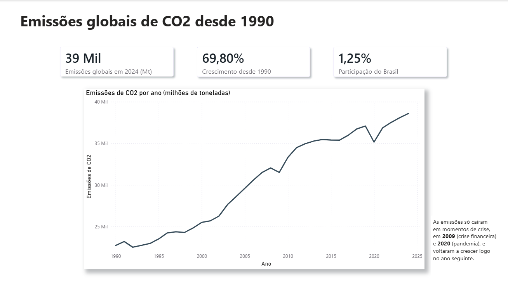
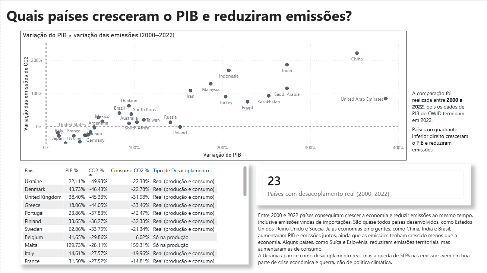
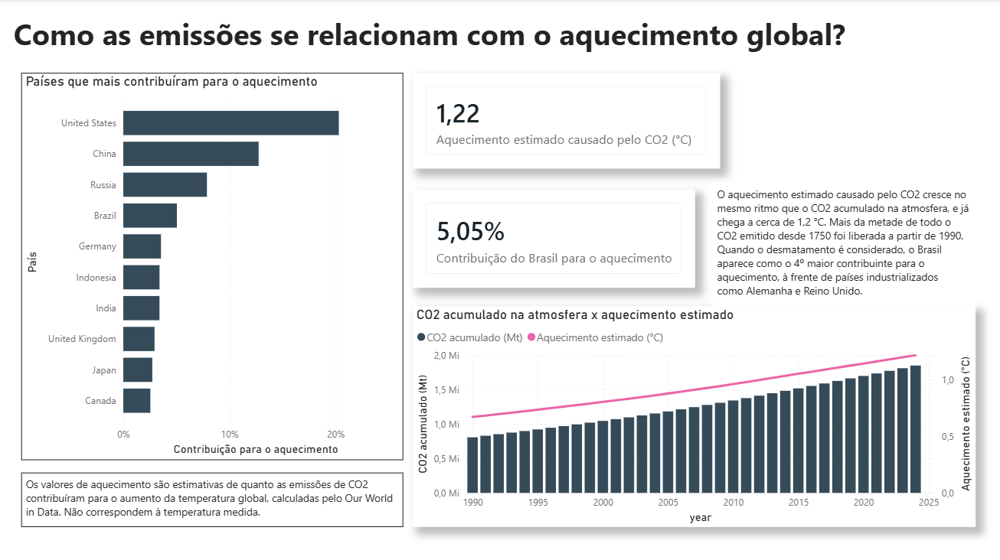

# Global CO2 Emissions Dashboard | Power BI

An end-to-end data analysis project on global carbon dioxide emissions from 1990 to 2024, built in Power BI with data from **Our World in Data**. The dashboard answers six questions about who emits, how emissions have changed, where they come from, whether economic growth can happen without more emissions, Brazil's role, and the link between emissions and global warming.

> The dashboard itself is in Portuguese. This README is in English.



---

## Table of contents

1. [Questions answered](#questions-answered)
2. [Key findings](#key-findings)
3. [Dashboard pages](#dashboard-pages)
4. [Data source](#data-source)
5. [Process](#process)
6. [Data model](#data-model)
7. [DAX measures](#dax-measures)
8. [Methodological notes and limitations](#methodological-notes-and-limitations)
9. [What I learned](#what-i-learned)
10. [How to open the project](#how-to-open-the-project)

---

## Questions answered

The questions were defined **before** building any visual, so every chart has a reason to exist:

1. Which country emits the most today, and which has emitted the most throughout history?
2. How have global emissions evolved since 1990?
3. Which source (coal, oil, gas or cement) has the largest impact worldwide?
4. Which countries managed to grow their GDP while reducing emissions (decoupling)?
5. What is Brazil's share of global emissions, how has it changed, and what is its main source today?
6. How do accumulated emissions relate to global warming?

---

## Key findings

**Global emissions keep growing.** Fossil CO2 emissions reached about **38,600 Mt in 2024**, roughly **70% higher than in 1990**. Emissions only fell during crises, in **2009** (financial crisis) and **2020** (pandemic), and recovered the following year in both cases.

**Today's largest emitter is not history's largest emitter.** China leads annual emissions in 2024, but the **United States** still leads cumulative emissions since 1750. The **United Kingdom, France and Canada** are in the historical top 10 but not in the current one, reflecting their early industrialization.

**Coal overtook oil.** Coal is the largest source in 2024 (**~42%** of emissions from the four main sources), followed by oil (**~33%**), gas (**~21%**) and cement (**~4%**). In 1990, however, oil was the largest source; coal overtook it in the mid-2000s after a sharp rise between 2002 and 2011. Natural gas was the fastest-growing source in relative terms, roughly doubling since 1990.

**Absolute decoupling is real, but concentrated in developed countries.** Between 2000 and 2022, **23 countries** grew their GDP while reducing both production-based and consumption-based emissions. Examples: the **United Kingdom** (GDP +38%, CO2 −45%), **Sweden** (GDP +63%, CO2 −34%) and the **United States** (GDP +51%, CO2 −16%). Emerging economies such as China, India and Brazil increased both GDP and emissions, although emissions grew more slowly than the economy (*relative* decoupling). Some countries, such as **Switzerland** and **Slovenia**, reduced territorial emissions while their consumption-based emissions increased, which suggests part of their pollution moved abroad through imports.

**Brazil's emissions are mostly about deforestation, not fossil fuels.** Considering only fossil fuels and industry, Brazil accounts for about **1.25%** of global emissions, with oil as its main source. When land-use change (mainly deforestation) is included, its share rises to about **5%**, and land use represents roughly **80%** of Brazil's CO2 emissions in 2024. Land-use emissions peaked in **2003**, dropped sharply until around 2010, and have risen again in recent years.

**Warming tracks accumulated CO2.** The estimated warming caused by CO2 reached about **1.2 °C** and rises in step with the CO2 accumulated in the atmosphere. More than half of all CO2 emitted since 1750 was released after 1990. When deforestation is counted, **Brazil is the 4th largest contributor to warming (~5%)**, ahead of Germany and the United Kingdom.

---

## Dashboard pages

| Page | Question | Main visuals |
|---|---|---|
| **Overview** | How have emissions evolved since 1990? | KPI cards, line chart of global emissions |
| **Rankings** | Who emits the most today and historically? | Top 10 bar charts: 2024 emissions × cumulative emissions |
| **Sources** | Which source weighs the most? | Stacked area chart (1990–2024), donut chart (2024 share) |
| **Decoupling** | Who grew GDP and reduced emissions? | Scatter plot with quadrants, table by decoupling type, KPI card |
| **Brazil** | What is Brazil's role? | Share cards (with and without deforestation), share over time, sources over time |
| **Climate** | How do emissions relate to warming? | Combo chart (cumulative CO2 × estimated warming), top 10 contributors |

| | |
|---|---|
|  |  |
|  |  |
|  | |

---

## Data source

**Our World in Data, CO2 and Greenhouse Gas Emissions dataset** (`owid-co2-data.csv`), available at [github.com/owid/co2-data](https://github.com/owid/co2-data).

The dataset compiles data mainly from the Global Carbon Budget, with GDP and population series from other sources and warming estimates based on Jones et al. It is published by Our World in Data under the CC BY license.

**Raw file:** about 50,000 rows and around 80 columns, in long format (one row per country per year, from the 1700s to 2024), including regional and income-group aggregates.

**Columns used:** `country`, `year`, `iso_code`, `population`, `gdp`, `co2`, `co2_per_capita`, `coal_co2`, `oil_co2`, `gas_co2`, `cement_co2`, `share_global_co2`, `cumulative_co2`, `land_use_change_co2`, `co2_including_luc`, `consumption_co2`, `temperature_change_from_co2`.

---

## Process

### 1. Defining questions
The six questions above were defined first and mapped to dashboard pages and to the dataset columns needed to answer them.

### 2. Exploration
A first look in Excel showed that the file is in long format: what looked like "duplicated" countries were actually one row per country per year, which is exactly the shape a fact table needs.

### 3. Data cleaning in Power Query
- **Import with the correct locale:** the CSV uses a comma as delimiter and a period as decimal separator, while Brazilian Portuguese settings use the opposite. The file's import locale was set to English (United States) so numbers would not be misread (e.g. `12.345` being read as twelve thousand).
- **Column selection:** kept only the columns needed for the questions.
- **Separating countries from aggregates:** rows without `iso_code` (such as "World", "Europe", "High-income countries") and codes starting with `OWID` were removed from the country table.
- **Separate world table:** a duplicated query kept only the "World" rows, used as the denominator for global shares.
- **Time range:** filtered to 1990 onward. Cumulative values still cover the period since 1750, because they come pre-calculated in the dataset.
- **Data types:** all numeric columns converted to decimal number and validated against known values (e.g. Brazil's 2024 emissions).

Result: about 7,000 rows in the main fact table instead of 50,000.

### 4. Data modeling
A star schema with two fact tables and two dimensions (see below).

### 5. DAX measures
KPIs created as measures rather than calculated columns, so they respond to filters (country, year) correctly.

### 6. Report design
One question per page, phrased as the page title; consistent colors for each emission source across pages; a written insight on every page; methodological notes where the data could be misread.

---

## Data model

```
          dPais (country, iso_code)
                   │ 1
                   │
                   ▼ *
dAno (year) ──1──► Emissoes (fact: one row per country per year)
      │
      └──1──► Mundo (fact: one row per year, world totals)
```

- **`Emissoes`**: fact table with country-level data.
- **`Mundo`**: fact table with world totals, used to calculate shares.
- **`dPais`**: country dimension (unique `iso_code`).
- **`dAno`**: year dimension. Because it filters both fact tables, a single year selection applies to country values and world totals at the same time.

All relationships are one-to-many with single-direction filtering. Fact table key columns are hidden from the report view, so visuals always use the dimensions.

---

## DAX measures

| Measure | Purpose |
|---|---|
| `Emissoes Total` | Sum of CO2 emissions (fossil fuels and industry) |
| `Emissoes Mundo` | World total, from the `Mundo` table |
| `Participacao Global` | Country share of world emissions |
| `Emissoes per Capita` | Total emissions divided by total population |
| `Acumulado Historico` | Cumulative emissions since 1750, taken from the last selected year only |
| `Carvao`, `Petroleo`, `Gas`, `Cimento`, `Uso da Terra` | Emissions by source |
| `Var Mundo desde 1990 %` | Global growth between 1990 and 2024 |
| `Var PIB %`, `Var CO2 %`, `Var CO2 Consumo %` | Change between 2000 and 2022 |
| `Desacoplou`, `Desacoplou Consumo` | Whether GDP rose while emissions fell |
| `Tipo de Desacoplamento` | Classifies countries as real decoupling, production-only, or no decoupling |
| `Paises Desacoplados` | Count of countries with real decoupling |
| `Emissoes com Uso da Terra`, `Participacao com Uso da Terra` | Emissions and share including deforestation |
| `Aquecimento Mundo`, `Acumulado Mundo`, `Contribuicao Aquecimento` | Estimated warming and each country's contribution |

Selected examples:

```DAX
Emissoes per Capita =
DIVIDE([Emissoes Total] * 1000000, SUM(Emissoes[population]))
```
Per capita is recalculated from totals instead of summing the `co2_per_capita` column, because adding up per-capita values across countries or years gives meaningless results.

```DAX
Acumulado Historico =
VAR UltimoAno = MAX(dAno[year])
RETURN CALCULATE(SUM(Emissoes[cumulative_co2]), dAno[year] = UltimoAno)
```
`cumulative_co2` is already a running total, so summing it across years would count the same emissions many times. The measure takes only the value of the last year in context.

```DAX
Tipo de Desacoplamento =
SWITCH(
    TRUE(),
    [Desacoplou] = "Sim" && [Desacoplou Consumo] = "Sim", "Real (produção e consumo)",
    [Desacoplou] = "Sim" && [Desacoplou Consumo] = "Não", "Só na produção",
    [Desacoplou] = "Não", "Não desacoplou"
)
```

---

## Methodological notes and limitations

- **`co2` excludes land-use change.** The main emissions column covers fossil fuels and industry only. Deforestation is in `land_use_change_co2`, which is essential for countries like Brazil and Indonesia.
- **Country shares do not add up to 100%.** About 3% of global emissions (international aviation and shipping, for example) is not attributed to any country.
- **The four sources do not add up to the total.** Coal, oil, gas and cement leave out flaring and other industrial emissions.
- **The decoupling period is 2000 to 2022**, because GDP data in the dataset ends in 2022. The rest of the dashboard goes to 2024.
- **Production vs. consumption.** Production-based emissions count what is emitted inside a country; consumption-based emissions adjust for trade. A country can reduce the first while increasing the second by importing more. Consumption data covers fewer countries.
- **Not every reduction is good news.** Ukraine, for example, shows a large emission drop that is largely explained by economic crises and war rather than climate policy.
- **Warming values are estimates**, not measured temperatures. They represent how much CO2 emissions are estimated to have contributed to global temperature rise.
- **Absolute vs. relative decoupling.** The dashboard measures absolute decoupling (emissions fall while GDP rises). Countries whose emissions grow more slowly than GDP show only relative decoupling.

---

## What I learned

### Power BI and Power Query
- How **regional settings** affect data import: a CSV with a period as decimal separator is misread under Brazilian settings, producing numbers thousands of times too large. Setting the import locale per file fixed it.
- How automatic **"Changed Type" steps** can silently break data, and how to diagnose errors through **Applied Steps**, **Keep Errors** and **View Errors**.
- The difference between **Reference** (follows the final result of another query) and **Duplicate** (independent copy).
- Filter lists only show values from the first 1,000 rows of the preview; text and number filters apply to the whole dataset.
- Using **column quality and profiling** to check for errors and empty values.

### Data modeling
- Building a **star schema** with fact and dimension tables, and why shared dimensions let one filter apply to multiple fact tables.
- **Relationship cardinality and filter direction**, and how Power BI's auto-detected relationships can create ambiguous paths that deactivate the relationships you actually need.

### DAX
- `CALCULATE` with filter arguments to compare fixed years regardless of the visual's context.
- Variables (`VAR`), `DIVIDE` for safe division, `SWITCH(TRUE())` for classification, and `FILTER` + `COUNTROWS` for counting.
- Why **averages and running totals cannot simply be summed**.
- Using **Top N** and measure-based visual filters, and checking that a copied visual's filter uses the right measure.

### Data visualization
- Starting from questions rather than charts, and writing an **insight on every page**.
- Keeping **consistent colors** for the same category across pages.
- Checking **dual-axis scales**, since an axis that doesn't start at zero can exaggerate a trend.
- Validating every chart against known figures before trusting it.

### About the topic
- The difference between **annual and cumulative** responsibility for emissions.
- How much **deforestation** changes the picture for Brazil.
- The concepts of **absolute vs. relative decoupling** and **production vs. consumption** emissions.

---

## How to open the project

1. Install [Power BI Desktop](https://powerbi.microsoft.com/desktop/) (free, Windows).
2. Download `owid-co2-data.csv` from [github.com/owid/co2-data](https://github.com/owid/co2-data).
3. Open the `.pbix` file in this repository. If prompted, point the data source to the downloaded CSV (**Transform data → Data source settings**).

### Repository structure

```
├── README.md
├── emissoes-co2.pbix
└── images/
    ├── 01-overview.png
    ├── 02-rankings.png
    ├── 03-sources.png
    ├── 04-decoupling.png
    ├── 05-brazil.png
    └── 06-climate.png
```

---

**Author:** Isadora Spode, Software Engineering student at PUCRS
